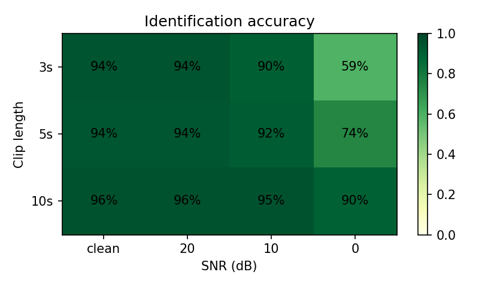
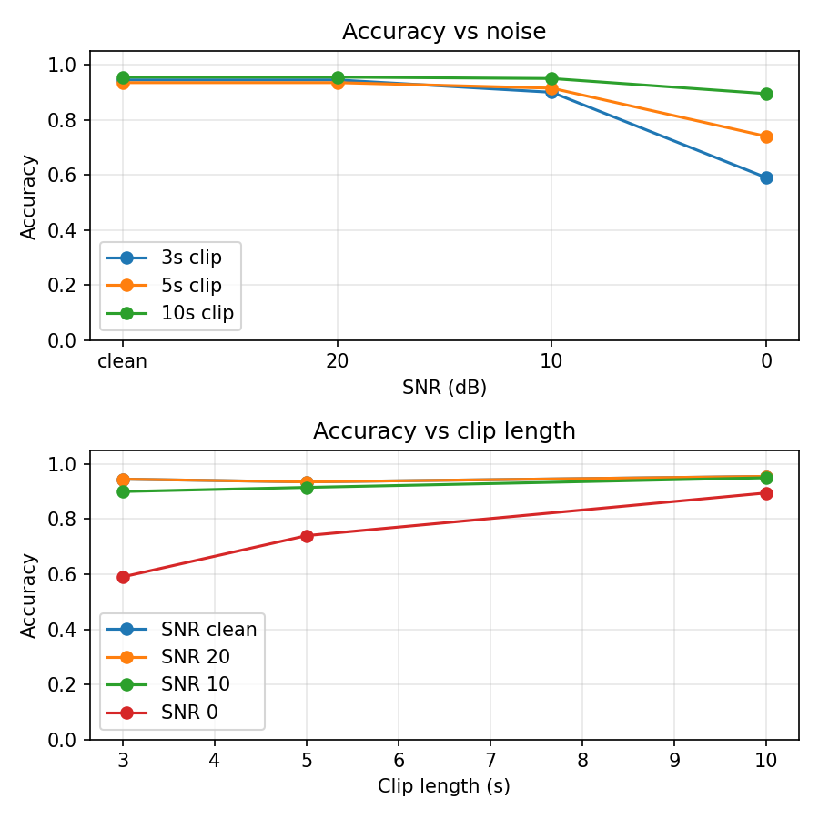

# 🎵 Mini Shazam: Audio Fingerprinting from Scratch

**[▶ Live demo](https://audio-fingerprinting-pkv.streamlit.app)** &nbsp;|&nbsp; Python · NumPy · SciPy · Streamlit


## Problem
Given a few seconds of audio, possibly noisy and cut from anywhere in a song, identify which track it came from. This project re-implements the core idea behind Shazam without any ML library: classic signal processing + hashing + indexing.

## How it works
```
audio clip -> spectrogram -> peaks -> hash pairs -> sorted DB lookup -> offset voting -> song
```
1. **Spectrogram (STFT):** frequency vs time picture of the audio.
2. **Constellation map:** keep only local maxima that are loud. They survive noise and compression.
3. **Hashing:** pair each peak with the next 10 peaks; pack `(f1, f2, Δt)` into one 30-bit integer. The hash is independent of absolute time, so any clip position works.
4. **Compact index:** all hashes of all tracks live in three sorted numpy arrays (`uint32` hash, `uint16` song, `uint16` time, 8 bytes/entry) and are searched with `np.searchsorted`.
5. **Offset voting:** for each candidate song compute `t_song - t_clip` for every matching hash. A true match gives a sharp spike at one offset; wrong songs give scattered offsets. Score = height of the spike, confidence = best score / second-best score.

## Results
Dataset: GTZAN (999 usable tracks × 30 s; one corrupt file skipped). N = 200 random queries per cell, seed = 42.

| Clip length | SNR clean | SNR 20 dB | SNR 10 dB | SNR 0 dB |
|---|---|---|---|---|
| 3 s | 94% | 94% | 90% | 59% |
| 5 s | 94% | 94% | 92% | 74% |
| 10 s | 96% | 96% | 95% | 90% |




## Tech stack
NumPy, SciPy (STFT, maximum filter), librosa (audio decoding only), Matplotlib, pandas, Streamlit, pytest, Docker.

## Run locally
```bash
git clone https://github.com/piyushvedwal/audio-fingerprinting.git && cd audio-fingerprinting
python -m venv venv && venv\Scripts\activate        # Mac/Linux: source venv/bin/activate
pip install -r requirements-dev.txt
pytest -q                                            # no dataset needed

# 1) build the DB offline (needs the raw audio, e.g. GTZAN in data/)
python scripts/build_db.py --data data/genres_original --out db/fingerprints.npz
# 2) evaluate (writes assets/results.csv + plots)
python scripts/evaluate.py --data data/genres_original
# 3) demo clips for the app (only use tracks you may share!)
python scripts/make_samples.py --data data/genres_original --n 4
# 4) run the app
streamlit run app.py
```
Deployment instructions: see [DEPLOY.md](DEPLOY.md).

## Project structure
```
src/            fingerprint.py (DSP), database.py (compact index), match.py (voting),
                utils.py (audio loading/validation), plots.py
scripts/        build_db.py, evaluate.py, make_samples.py
tests/          test_basic.py (determinism, self-match, noisy match, DB round-trip)
db/             fingerprints.npz  (precomputed; the live app never needs raw audio)
samples/        demo clips          assets/  README images + results.csv
app.py          Streamlit UI        Dockerfile, packages.txt, requirements.txt
```

## Limitations
- Pitch shift and tempo change are not handled (hashes depend on exact frequency bins).
- Only 999 tracks (GTZAN, genre-labelled clips, no artist/title metadata).
- Detection thresholds (`MIN_SCORE`, `MIN_RATIO`) are fixed heuristics, not tuned per dataset or noise type.
- White noise is not the same as real-world noise (room echo, crowd, phone speaker).

## Future work
Locality-sensitive hashing / tolerance to ±1 frame jitter, a larger dataset (FMA medium), SQLite or FAISS backed index, pitch-invariant landmarks, real phone-recording evaluation.

## License
MIT
